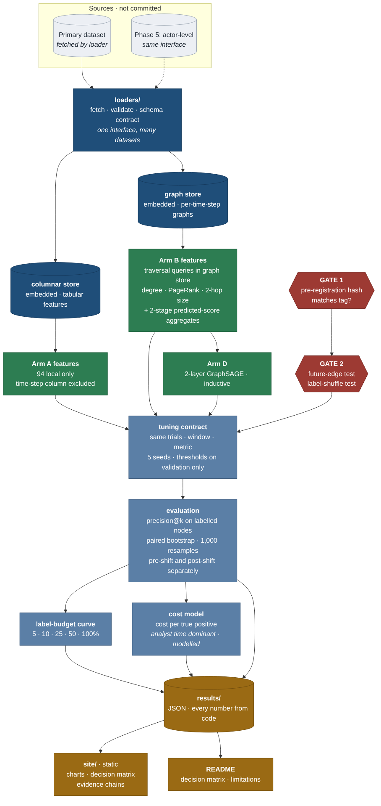
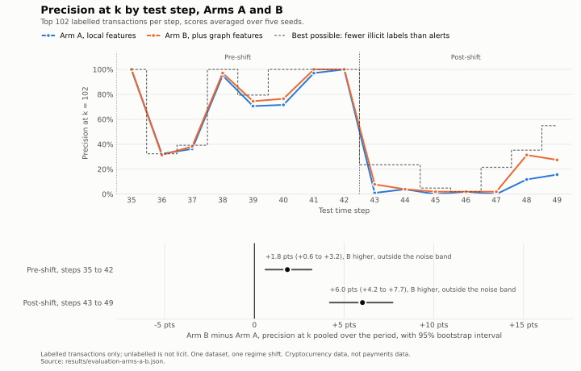

# graph-risk-evals

**When does a graph earn its cost in fraud and AML detection?**

A pre-registered, reproducible lab comparing a clean tabular baseline, graph-derived features and a graph neural network on a published transaction graph. Measured on detection lift at a fixed alert budget and on cost per true positive.

> **Status: in progress.** The pre-registration is committed and tagged. Results appear below as phases complete. Every figure on this page is read from `results/` and generated by code.

---

## How to read this repo

1. **[The decision matrix](#the-decision-matrix)** — what the result means, if you read nothing else.
2. **[The ladder](#the-escalation-ladder)** — the organising argument.
3. **[`01-the-bet/pre-registration.md`](01-the-bet/pre-registration.md)** — the hypotheses, committed before any result and hash-enforced by the pipeline.
4. **[Limitations](#limitations)** — what this demonstrates, what it suggests, and what it cannot establish.
5. **[`prds/prd-v2.md`](prds/prd-v2.md)** — the full specification.
6. **[`docs/prd-review.md`](docs/prd-review.md)** — two independent model reviews of the spec, what was acted on and what was not.

---

## The question

Organised fraud lives in the relationships between accounts, so evidence relevant to one entity may sit with its neighbours. Graph methods exist to exploit that. They are also expensive to operate, hungry for labels that arrive late and rarely, and harder to explain to an investigator or a regulator than the methods they replace.

This is not a test of whether graphs can find rings. They can. It is a test of whether the lift justifies the cost, against a baseline tuned as hard as the graph model.

**What this does not claim.** Transaction-level monitoring is not incapable of catching organised fraud. A well-engineered tabular model captures relational signal indirectly. That is exactly what Arm A against Arm B measures.

---

## The escalation ladder

Each rung is climbed only once the one below has been measured and plateaued.

| Rung | Method | In this lab |
|---|---|---|
| 1 | Rules and thresholds | Context only |
| 2 | Local features in a tuned tabular model | **Arm A** |
| 3 | Graph-derived features added to that model | **Arm B** |
| 4 | Graph algorithms proper | Deferred |
| 5 | Graph neural networks | **Arm D** |

---

## The decision matrix

<!-- generated:decision-matrix by 00-build/render_readme.py from results/; do not edit by hand -->
_Populated from `results/` when Phase 3 completes._

| Finding | Product decision | Evidence |
|---|---|---|
| Tabular performs comparably to graph features | Do not introduce graph complexity | _pending_ |
| Graph features materially improve detection economics | Invest in graph-derived features, not graph models | _pending_ |
| The GNN adds material value beyond graph features | Investigate whether the operational burden is justified | _pending_ |
| All arms perform similarly | Do not invest further on the basis of this dataset | _pending_ |
<!-- end generated:decision-matrix -->

---

## Experiment junctions


Every path terminates in a publishable finding, including the two that stop the experiment early. That is what pre-registration buys.

## Architecture



Two gates can halt the pipeline. **Gate 1** checks the pre-registration hash against its tag before anything is written to `results/`. **Gate 2** runs three leakage tests before any arm is tuned: insert a future edge and assert no earlier feature value changes; shuffle the test labels and assert no feature value changes at all; flip sampled training labels and assert those nodes' own neighbour-score features do not move. Results in `results/leakage-tests.json`.

---

## Results

_Populated as phases complete. Nothing here is hand-entered._

<!-- generated:results by 00-build/render_readme.py from results/; do not edit by hand -->
| Arm | Precision at k, pre-shift | Precision at k, post-shift | PR-AUC, pre-shift | PR-AUC, post-shift | Cost per true positive |
|---|---|---|---|---|---|
| A, 93 local features | 75.4% (71.4% to 78.2%) | 4.9% (3.4% to 6.7%) | 90.3% (88.8% to 91.7%) | 3.4% (2.7% to 4.6%) | Phase 3 |
| B, plus graph features | 77.2% (73.3% to 80.3%) | 10.9% (8.7% to 13.2%) | 92.0% (90.6% to 93.4%) | 5.1% (4.3% to 6.5%) | Phase 3 |
| B minus A | +1.8 pts (+0.6 pts to +3.2 pts), B higher, outside the noise band | +6.0 pts (+4.2 pts to +7.7 pts), B higher, outside the noise band | +1.7 pts (+1.2 pts to +2.2 pts), B higher, outside the noise band | +1.8 pts (+1.3 pts to +2.3 pts), B higher, outside the noise band | |
| D, GraphSAGE | Phase 3 | | | | |

k = 102 alerts per time step (`results/k.json`). PR-AUC is average precision pooled over labelled transactions in the period. Brackets are 95% paired bootstrap intervals, 1,000 resamples stratified by time step. A difference is called only when its interval excludes zero. Labelled transactions only; unlabelled is not licit. Source: `results/evaluation-arms-a-b.json`.



**Phase 2 finding (draft for the author to edit).** Adding graph features lifted precision at k before the regime shift: B minus A was +1.8 pts (+0.6 pts to +3.2 pts), B higher, outside the noise band. Arm D is built in Phase 3 to test whether learned message passing adds more than hand-built graph features. After the shift at step 43, precision at k was 4.9% for A and 10.9% for B; B minus A +6.0 pts (+4.2 pts to +7.7 pts), B higher, outside the noise band. There are fewer illicit labels than alerts after the shift, so no model could exceed 23.7% there (before the shift the ceiling is 81.4%). Mean per-step PR-AUC fell by 89.0% for A and 85.5% for B from the pre-shift to the post-shift period. H3 is assessed across all arms in Phase 3. This is one Bitcoin transaction graph with anonymised features. It says nothing directly about account-level payments graphs. The post-shift period has few illicit labels, which caps precision at k there.
<!-- end generated:results -->

### Hypotheses

<!-- generated:hypotheses by 00-build/render_readme.py from results/; do not edit by hand -->
_Assessed when Phase 3 completes, against the rules in [`01-the-bet/pre-registration.md`](01-the-bet/pre-registration.md) and [`change_log.md`](change_log.md)._
<!-- end generated:hypotheses -->

---

## Deliverables at a glance

| # | Deliverable | Phase | Status | File |
|---|---|---|---|---|
| 1 | Pre-registration, tagged and hash-enforced | 1 | Done | [`01-the-bet/pre-registration.md`](01-the-bet/pre-registration.md) |
| 2 | Loader and schema contract | 1 | Done | `loaders/` |
| 3 | Thin end-to-end slice | 1 | Done | `00-build/` |
| 4 | Arm A, 93 local features, time step excluded | 2 | Done | `00-build/` |
| 5 | Arm B, traversal queries | 2 | Done | [`graph/queries/`](graph/queries/) |
| 6 | Leakage tests | 2 | Done | `00-build/leakage_gate.py`, `tests/` |
| 7 | Arm D, GraphSAGE | 3 | — | `00-build/` |
| 8 | Label-budget curve | 3 | — | `results/` |
| 9 | Cost per true positive | 3 | — | `03-the-margin/` |
| 10 | Decision matrix | 4 | — | this README |
| 11 | Evidence chains | 4 | — | `results/` |
| 12 | Entity resolution note | 4 | — | `docs/entity-resolution.md` |
| 13 | Governance and sovereignty note | 4 | — | `06-governance/` |
| 14 | Decision log | 4 | — | `07-decision-log/` |
| 15 | Engine comparison appendix | 4 | — | `docs/engine-comparison.md` |

---

## Limitations

Separated deliberately into three categories.

<!-- generated:limitations by 00-build/render_readme.py from results/; do not edit by hand -->
**What this demonstrates.** _pending results._

**What this suggests.** _pending results._
<!-- end generated:limitations -->

**What this cannot establish.**

- **Anything about payments.** The nodes are cryptocurrency transactions with anonymised features. There are no accounts, devices, addresses or opening dates. Three features a payments fraud system would use are not computable here and are described only as what they would be on payments data.
- **Anything about real-time performance.** The dataset is static and small. Ingest throughput, concurrency and freshness are not testable and no claim is made about them.
- **Production economics at scale.** The cost model is modelled, not measured, and dominated by an assumed analyst cost per alert with a stated sensitivity range.
- **Generalisation from one dataset.** One graph, one regime shift, one label distribution.

**Prior work.** The headline comparison on this dataset has been published. A random forest on the full feature set outperformed a two-layer graph convolutional network, and performance collapsed after the regime shift. This lab adds a cleanly separated baseline, a fixed alert budget, cost per true positive, a label-budget curve, and an equal documented tuning protocol.

---

## Other graph use cases, deliberately not built

Named so the scope is visible rather than implied.

| Use case | Why not here |
|---|---|
| Entity resolution and Customer 360 | The layer beneath every fraud graph. Not demonstrable on this data, which has no entities to resolve. See [`docs/entity-resolution.md`](docs/entity-resolution.md) |
| Knowledge graphs and GraphRAG | Different architecture, different problem |
| Recommendation engines | A legitimate graph use case, off-topic here |
| Multi-tier supply chain | Same, and a different domain |
| Cybersecurity and dependency mapping | Same |
| Access control reachability | Same |

---

## Planned extension, Phase 5

An actor-level extension of the same dataset adds roughly 822,000 wallet-address nodes with their own features, plus real address-to-address, address-to-transaction and transaction-to-address edge sets. That gives **entity nodes rather than transaction nodes**, actor-to-actor edges in the shape a mule network actually takes, and a genuinely heterogeneous graph.

Datasets sit behind a loader interface from the first commit, so this is additive rather than a rebuild. Three things to settle before adopting it: the compute budget at roughly twenty times the edge count, overlap between its added structural features and those computed here, and the prior work already published on it.

---

## Running it

```bash
make all
```

One command on a clean clone. Pinned versions, laptop CPU, under 30 minutes. Datasets are fetched by script and never committed. Needs [uv](https://docs.astral.sh/uv/) or Python 3.13; see `00-build/NOTES.md`.

---

## Repo structure

```
00-build/                 pipeline: loaders, features, arms, evaluation
01-the-bet/               pre-registration, hypotheses, kill criteria
02-the-decision/          the ladder, build-vs-buy, rung selection
03-the-margin/            cost model, assumptions, sensitivity
04-the-data/              dataset notes, labels, leakage tests
05-evals-and-guardrails/  eval stack, red lines, review queue
06-governance/            controls, data protection, sovereignty
07-decision-log/          anonymised production decisions, mapped to rungs
graph/queries/            traversal queries for Arm B features
results/                  JSON. every number on this page comes from here
site/                     static front end
prds/                     versioned PRDs, never overwritten
docs/                     review disposition, notes, diagrams
```

---

## Related work in this portfolio

Conventions, eval structure, strategy framing and roadmap format are carried across rather than reinvented: [`ai-evals`](https://github.com/igoko-consulting/ai-evals), [`my-AI-product-strategy`](https://github.com/igoko-consulting/my-AI-product-strategy), [`juno-pm`](https://github.com/igoko-consulting/juno-pm), [`pm-os-agent`](https://github.com/igoko-consulting/pm-os-agent), [`product-leadership`](https://github.com/igoko-consulting/product-leadership).

---

MIT licensed. Datasets are not redistributed; see `04-the-data/` for sources and terms.
