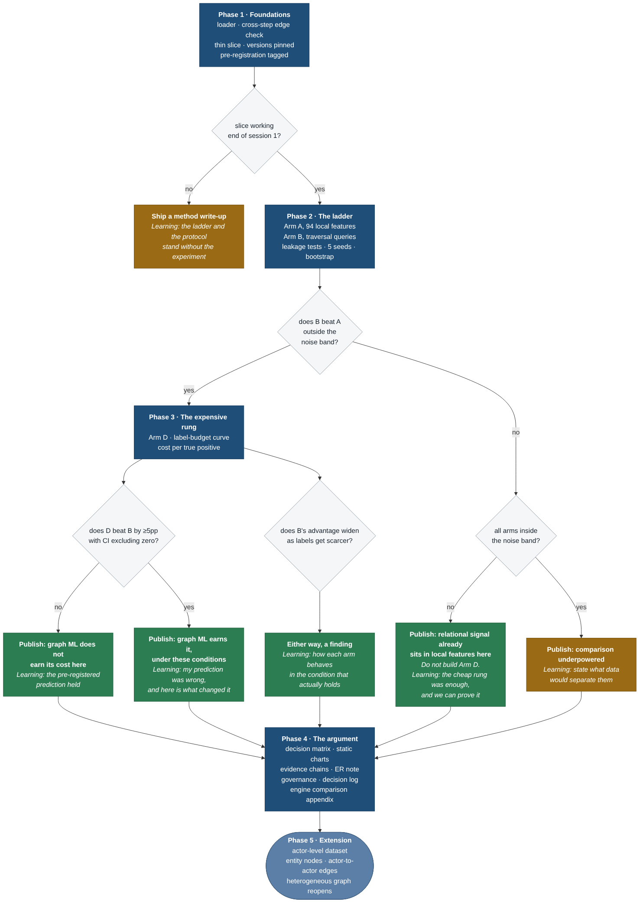
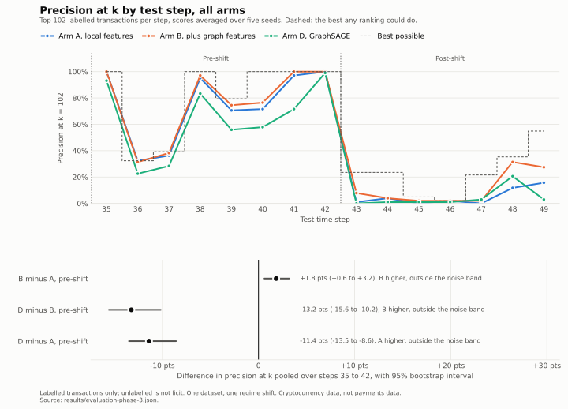
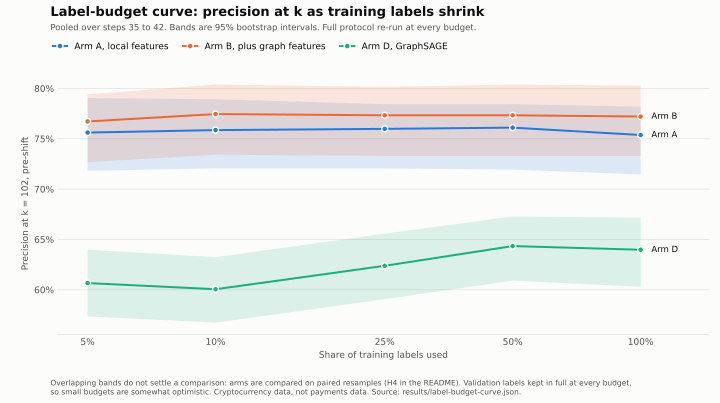
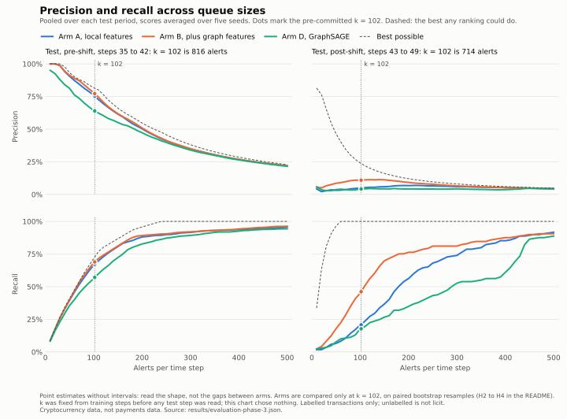

# graph-risk-evals

**When does a graph earn its cost in fraud and AML detection?**

A pre-registered, reproducible lab comparing a clean tabular baseline, graph-derived features and a graph neural network on a published transaction graph. Each is measured on detection lift at a fixed alert budget and on cost per true positive.

## The answer

<!-- generated:answer by 00-build/render_readme.py from results/; do not edit by hand -->
Before the regime shift, adding graph features to a tuned tabular model raised precision at k by +1.8 pts (+0.6 pts to +3.2 pts): 630 illicit transactions found in 816 alerts, against 615 without them. The graph neural network ranked below the graph features, at -13.2 pts (-15.6 pts to -10.2 pts). After the shift, every arm's precision at k fell to between 4.2% and 10.9%. Modelled cost per true positive ranks the arms in the same order as precision at k, because every arm works the same number of alerts.

**Decision, for this Bitcoin dataset only: invest in graph-derived features, not graph models.** Costs are modelled, not measured. Nothing here transfers to payments without the account-level data this dataset lacks. Sources: `results/evaluation-phase-3.json`, `results/cost-per-true-positive.json`.
<!-- end generated:answer -->

> **Status.** Phases 1 to 4 are built and have run end to end from a clean clone. Still with the author: reviewing the items marked [in review] and scoring the evidence-chain review sample. Every result on this page, and every count, setting and assumption the pipeline uses, is read from `results/` and written by code, including those quoted in prose.

---

## How to read this repo

If you have five minutes:

1. **[What kind of project this is](#what-kind-of-project-this-is):** the scope, the time box and what they rule out.
2. **[The decision matrix](#the-decision-matrix):** what the result means for a product decision.
3. **[Key decisions and their reasoning](#key-decisions-and-their-reasoning):** the calls that shape the result, what else was considered, and what each one costs.
4. **[Limitations](#limitations):** what this demonstrates, what it suggests, and what it cannot establish.

If you want to check the work:

5. **[`01-the-bet/pre-registration.md`](01-the-bet/pre-registration.md):** the hypotheses, committed before any result and hash-enforced by the pipeline.
6. **[`prds/prd-v2.md`](prds/prd-v2.md):** the specification. [`docs/prd-review.md`](docs/prd-review.md) records two independent model reviews of it, what was acted on and what was not.
7. **[`change_log.md`](change_log.md):** every decision made during the build, dated, including the few made after a result was seen and why.
8. **[Running it](#running-it):** one command on a clean clone.

---

## What kind of project this is

- **A learning project, run as a two-day discovery sprint.** Built on 19 and 20 November 2026, to answer one product question with evidence and to gain working knowledge of graph stores, traversal queries and graph neural network evaluation. The time box set the scope. It did not set the answer.
- **Discovery, not delivery.** The output is a decision and the evidence behind it, not a detection system. There is no serving layer, no deployment and no claim of production readiness.
- **One public dataset.** The Elliptic Bitcoin transaction graph: transactions as nodes, anonymised features, and most transactions unlabelled. It is not payments data. Nothing here should be read as a claim about payments without the account-level data this dataset lacks.
- **What the time box left out, on purpose.** An unsupervised arm, graph algorithms beyond Arm B's features, the interactive threshold explorer, a second dataset, continuous integration and adversarial tests. Each is deferred in the roadmap, not ruled out. See [Phase 5](#planned-extension-phase-5).
- **What it kept, despite the time box.** Pre-registration, leakage tests and equal tuning for every arm. Dropping any of them would have been quicker, and would have left a result nobody could trust. The price was runtime: the full protocol takes hours rather than the <!-- value:runtime-target-minutes -->30<!-- end value --> minutes the specification targeted.
- **How to read the drafts.** Text marked [in review] is not yet in its final form. The numbers inside it are generated and final; the wording around them is not.

---

## The question

Organised fraud lives in the relationships between accounts, so evidence relevant to one entity may sit with its neighbours. Graph methods exist to exploit that. They are also expensive to operate, hungry for labels that arrive late and rarely, and harder to explain to an investigator or a regulator than the methods they replace.

This is not a test of whether graphs can find rings. They can. It is a test of whether the lift justifies the cost, against a baseline tuned as hard as the graph model.

**Why it matters commercially.** In cross-border payments the margin kept per transaction is thin, and it is being compressed deliberately to win volume. Fraud losses, analyst time spent on false positives and the compute running detection all draw on that same slice. Of the costs this lab can model, analyst time dominates. Losses prevented are not modelled, because the dataset carries no transaction values. A detection capability has to pay for itself in alerts an investigator can work, not in compute.

**What this does not claim.** Transaction-level monitoring is not incapable of catching organised fraud. A well-engineered tabular model captures relational signal indirectly. That is exactly what Arm A against Arm B measures.

---

## The escalation ladder

The organising argument. Each rung is climbed only once the one below has been measured and plateaued.

| Rung | Method | In this lab |
|---|---|---|
| 1 | Rules and thresholds | Context only |
| 2 | Local features in a tuned tabular model | **Arm A** |
| 3 | Graph-derived features added to that model | **Arm B** |
| 4 | Graph algorithms proper | Deferred |
| 5 | Graph neural networks | **Arm D** |

Arm C, unsupervised community detection, was deferred, so the arm letters skip it. Rung 4 was deferred to fit the time box, so Arm D tests rung 5 directly against rung 3.

---

## The decision matrix

Each row pairs a possible finding with the product decision it would support. The rule for which row applies was written before Arm D ran, and code applies it to `results/`.

<!-- generated:decision-matrix by 00-build/render_readme.py from results/; do not edit by hand -->
| Finding | Product decision | Applies here | Evidence |
|---|---|---|---|
| Tabular performs comparably to graph features | Do not introduce graph complexity | No | B minus A, precision at k pre-shift: +1.8 pts (+0.6 pts to +3.2 pts), B higher, outside the noise band |
| Graph features improve detection economics | Invest in graph-derived features, not graph models | **Yes** | B beats A outside the noise band: yes. Before the shift, B found 630 illicit transactions in 816 alerts, against A's 615. Modelled cost per true positive: A €33.17, B €32.38 |
| The GNN adds material value beyond graph features | Investigate whether the operational burden is justified | No | D minus B: -13.2 pts (-15.6 pts to -10.2 pts), B higher, outside the noise band. H2 stands: the GNN does not clear the bar |
| All arms perform similarly | Do not invest further on the basis of this dataset | No | No: B minus A, D minus B and D minus A are outside the noise band |

[in review] _Which row applies is decided by code from `results/`, using rules written before Arm D ran. The product decisions are the PRD's; they are about this dataset and do not transfer to payments without the account-level data this dataset lacks._
<!-- end generated:decision-matrix -->

---

## Key decisions and their reasoning

The calls that most shape the result. Each states why it was made, what it costs and what else was considered, so that it can be questioned. Dated entries are in [`change_log.md`](change_log.md); the reasoning behind the specification is in the PRD and its review.

### Product

- **Measure at a fixed alert budget, not at a threshold.** An operations team works a queue of fixed size, so precision at the top of that queue decides whether a model pays its way. k, <!-- value:k -->102<!-- end value --> alerts per step, is the mean number of illicit labels per step over steps <!-- value:k-first-step -->1<!-- end value --> to <!-- value:k-last-step -->34<!-- end value -->, the training and validation steps, computed before any test step is read (`results/k.json`). *Cost:* one operating point can flatter or penalise an arm, so the [queue-size chart](#queue-size-and-the-operating-point) shows every size from <!-- value:queue-smallest -->10<!-- end value --> to <!-- value:queue-largest -->500<!-- end value --> per step. *Considered:* a fixed top share of all scored transactions, which is defensible but arbitrary.
- **Cost per true positive, with analyst time as the main term.** A model is paid for in alerts an investigator can work, not in compute. *Cost:* the figure is modelled, not measured. It rests on an assumed <!-- value:analyst-cost -->€25<!-- end value --> per alert, published with a range of <!-- value:analyst-cost-low -->€12.50<!-- end value --> to <!-- value:analyst-cost-high -->€37.50<!-- end value -->. Because every arm works the same number of alerts, cost per true positive moves with precision at k; what it adds is the unit a budget holder uses, and how much compute contributes. Like precision at k, it counts labelled transactions only. *Considered:* list prices for compute and tooling, which would dominate a figure where they matter least.
- **A decision for every outcome.** The decision matrix has a row for each possible finding, including "do not invest further". *Cost:* it removes the option of telling a flattering story afterwards, which is the point.

### Method

- **A baseline that is genuinely graph-free.** Arm A uses the <!-- value:arm-a-features -->93<!-- end value --> local features only. The dataset's other <!-- value:aggregate-features -->72<!-- end value --> features are neighbour aggregates, which already carry graph information, and the time-step column is excluded so the model cannot key on when a transaction happened. *Why:* the published comparison on this dataset (Weber et al., 2019) put every feature in the baseline, so it could not isolate what the graph adds. *Cost:* Arm A is weaker than published baselines, so its figures do not compare directly with theirs. The pre-registration, the PRD and the diagrams count the time-step column among the local features; Arm A excludes it ([`change_log.md`](change_log.md), 2026-11-19).
- **Hypotheses committed and hash-enforced before any result.** The pipeline refuses to write a result if `01-the-bet/pre-registration.md` differs from its tag. *Why:* it turns a promise into a mechanism a reviewer can check. *Cost:* any wording changed after a result has to be logged as such, and is.
- **Equal tuning for every arm.** The same search method and trial budget for A, B and D: random search, <!-- value:trials-per-seed -->40<!-- end value --> trials for each of <!-- value:seeds -->5<!-- end value --> seeds, average precision on validation steps as the objective, thresholds and hyperparameters chosen on validation steps only. D's search space necessarily differs from the trees', and its compute is recorded. *Why:* a weak baseline is the most common way a graph model is made to look good. *Cost:* hours of runtime on a laptop.
- **Leakage tests as a gate.** Three tests run before any arm is tuned: a future edge, a shuffle of test labels, and a flip of a node's own training label. *Why:* Arm B's neighbour-score features are the obvious route for labels to leak in. *Cost:* minutes of runtime. Any feature that moves under the future-edge or label-shuffle test fails the gate, and no model result is written. A neighbour-score feature that moves only for transactions whose own labels were flipped is dropped, the one remedy the pre-registration allows. *What it leaves out:* the tests ran on one reference configuration with every training label. They check query scoping, which should not depend on tuning, but the tuned models and smaller label budgets were not re-tested.
- **A difference is called only outside the noise band.** Paired bootstrap, <!-- value:resamples -->1,000<!-- end value --> resamples stratified by time step. A difference whose interval includes zero is reported as not separable. *Cost:* several hypotheses end as "not separable", which is less satisfying to read and more honest. *What it leaves out:* retraining with other seeds, and dependence between linked transactions, so the interval may be too narrow; the notes under the results give the seed-by-seed spread.
- **Before and after the regime shift reported separately.** The dataset's own paper found every model degraded sharply after step <!-- value:shift-step -->43<!-- end value -->. Pooling the two periods would hide that.
- **One graph neural network, fixed in advance.** A two-layer GraphSAGE, inductive, with its search space set before any result and the same trial budget as the tree models. Its search space was not widened after its result was seen. *Why:* widening it then would let the result choose the protocol. *Cost:* a different architecture might do better. The limitations say so.

### Engineering

- **Arm B's graph features are queries in an embedded graph store.** Cypher queries in [`graph/queries/`](graph/queries/), run in LadybugDB, rather than calls to a Python graph library. *Why:* working knowledge of graph query languages is a stated aim of the lab, and the queries become an artefact a reader can inspect. *Cost:* speed. The same workloads ran <!-- value:engine-ratio-min -->2.2<!-- end value --> to <!-- value:engine-ratio-max -->45.0<!-- end value --> times faster in a columnar store, as the [engine comparison](docs/engine-comparison.md) records.
- **The engine comparison was kept against review advice.** Both reviews recommended cutting it, because at this size it mostly times start-up and caching. *Why kept:* the learning was worth more to the author than the risk. It was timeboxed to half a day and states its confounds beside its table.
- **Gradient-boosted trees from scikit-learn.** One fewer dependency to pin and reproduce than a dedicated boosting library. LightGBM and XGBoost also need a system library a stock Mac lacks, so scikit-learn's version runs from a clean clone with nothing installed by hand. *Cost:* the less common choice in practice, and possibly some speed; no claim is made about accuracy either way.
- **Static, reproducible, one command.** Pinned versions, laptop CPU, no server. Datasets are fetched by script and never committed, and only aggregates are published, because the dataset's licence (CC BY-NC-ND 4.0) does not allow redistribution. *Cost:* no interactive explorer yet.
- **Every number generated.** Tables, charts and the numbers in prose are written by code from `results/`, and each result records the commit and data that produced it. *Why:* it removes transcription errors and makes every figure traceable. *Cost:* prose is written around numbers it cannot see in advance, which is why some of it is marked [in review].
- **Deliberately not built.** An unsupervised community-detection arm, because on small disjoint per-step graphs scored against incomplete labels it gives a noisy result that does not serve the question. Language-model explanation summaries, because they add a second evaluation problem, faithfulness; deterministic evidence chains can be checked fact by fact.

---

## Experiment junctions



Every path terminates in a publishable finding, including the two that stop the experiment early. That is what pre-registration buys. The early stops are applied by reading the result: the Phase 2 kill criterion is computed and published in `results/evaluation-arms-a-b.json`, and the pipeline does not halt on it by itself.

## Architecture


Two gates can halt the pipeline. **Gate 1** checks the pre-registration hash against its tag before anything is written to `results/`. **Gate 2** runs the three leakage tests described under [Method](#method). Any movement under the future-edge or label-shuffle test halts the build. Results in `results/leakage-tests.json`.

---

## Results

Every figure below is written by code from `results/`.

<!-- generated:results by 00-build/render_readme.py from results/; do not edit by hand -->
| Arm | Precision at k, pre-shift | Precision at k, post-shift | PR-AUC, pre-shift | PR-AUC, post-shift | Cost per true positive, pre-shift | Cost per true positive, post-shift |
|---|---|---|---|---|---|---|
| A, 93 local features | 75.4% (71.4% to 78.2%) | 4.9% (3.4% to 6.7%) | 90.3% (88.8% to 91.7%) | 3.4% (2.7% to 4.6%) | €33.17 (€16.59 to €49.76) | €510 (€255 to €765) |
| B, plus graph features | 77.2% (73.3% to 80.3%) | 10.9% (8.7% to 13.2%) | 92.0% (90.6% to 93.4%) | 5.1% (4.3% to 6.5%) | €32.38 (€16.19 to €48.57) | €229 (€114 to €343) |
| D, GraphSAGE on local features | 64.0% (60.3% to 67.2%) | 4.2% (2.5% to 5.7%) | 79.9% (77.3% to 82.2%) | 2.8% (2.3% to 3.5%) | €39.08 (€19.54 to €58.62) | €595 (€298 to €893) |
| B minus A | **+1.8 pts** (+0.6 pts to +3.2 pts) | **+6.0 pts** (+4.2 pts to +7.7 pts) | **+1.7 pts** (+1.2 pts to +2.2 pts) | **+1.8 pts** (+1.3 pts to +2.3 pts) | | |
| D minus B | **-13.2 pts** (-15.6 pts to -10.2 pts) | **-6.7 pts** (-9.2 pts to -4.6 pts) | **-12.1 pts** (-14.1 pts to -10.1 pts) | **-2.3 pts** (-3.3 pts to -1.8 pts) | | |
| D minus A | **-11.4 pts** (-13.5 pts to -8.6 pts) | -0.7 pts (-2.8 pts to +1.0 pts) | **-10.3 pts** (-12.3 pts to -8.4 pts) | **-0.5 pts** (-1.5 pts to -0.2 pts) | | |

- **Reading the table.** k = 102 alerts per time step (`results/k.json`). PR-AUC is average precision pooled over labelled transactions in the period. Brackets on metrics are 95% paired bootstrap intervals, 1,000 resamples stratified by time step. A difference in **bold** is outside the noise band: its interval excludes zero. The others are not separable.
- **Labelled transactions only.** Unlabelled transactions are left out, not counted as licit. Ranked over every transaction in a step, unlabelled ones would fill 48.5% of A's top 102 before the shift, 49.4% of B's and 77.8% of D's. Precision at k describes only the labelled rest of the queue.
- **What the intervals leave out.** Each arm's scores are the mean of its 5 seeds' models, each tuned on its own; a deployment would run one model. The intervals hold those scores fixed and treat transactions within a step as independent, so they leave out retraining with other seeds and may be too narrow where linked transactions move together. Seed by seed, B minus A on pre-shift precision at k ran from +1.5 pts to +2.6 pts.
- **Cost is modelled, not measured.** Analyst cost of €25 per alert, plus measured tuning time priced at €0.05 per vCPU-hour. The bracket is the analyst-cost range of €12.50 to €37.50, not a confidence interval.

Sources: `results/evaluation-phase-3.json`, `results/cost-per-true-positive.json`.



**Phase 3 finding.** [in review] Before the regime shift, on point estimates, the arms ranked B, then A, then D on precision at k. B minus A was +1.8 pts (+0.6 pts to +3.2 pts), B higher, outside the noise band; D minus B -13.2 pts (-15.6 pts to -10.2 pts), B higher, outside the noise band; D minus A -11.4 pts (-13.5 pts to -8.6 pts), A higher, outside the noise band. Given A's local features plus the transaction graph, the GNN still ranked below A. That matches the direction of the published comparison (Weber et al., 2019). After the shift at step 43, precision at k was 4.9% for A, 10.9% for B and 4.2% for D, against a ceiling of 23.7% set by the number of illicit labels. This is one Bitcoin transaction graph with anonymised features. It says nothing directly about account-level payments graphs. Arm D's search space was fixed before any result and was not widened afterwards.
<!-- end generated:results -->

### Hypotheses

<!-- generated:hypotheses by 00-build/render_readme.py from results/; do not edit by hand -->
| Hypothesis | Outcome | Evidence |
|---|---|---|
| **H1.** Graph-derived features capture the majority of available lift | Supported, but trivially | Share of lift, PR-AUC pre-shift: 1 in every resample, because B beat D each time, so all the available lift was B's own. D's PR-AUC was also below A's (79.9% against 90.3%): the GNN added no lift for graph features to capture. The rule needs the whole interval at or above half. |
| **H2.** The GNN does not justify its cost | Stands: the GNN does not clear the bar | D minus B, precision at k pre-shift: -13.2 pts (-15.6 pts to -10.2 pts), B higher, outside the noise band. Rejected only if D - B, precision at k pooled pre-shift, is at least 5 points and its 95% interval excludes zero. |
| **H3.** Simpler arms degrade less after the regime shift | Not separable | Relative fall in mean per-step PR-AUC: A fell 89.0%; B fell 85.5%; D fell 92.6%. Differences in fall, positive where the more complex arm fell more: B minus A -3.5 pts (-7.3 pts to +2.8 pts), within the noise band; D minus B +7.1 pts (+3.6 pts to +16.8 pts), outside the noise band; D minus A +3.6 pts (-1.5 pts to +15.4 pts), within the noise band. Supported needs all three above zero. |
| **H4.** The graph-feature advantage widens as labels get scarcer | Not separable | B minus A, precision at k pre-shift: at 5% of training labels, +1.1 pts (-0.1 pts to +1.6 pts), within the noise band; at 100%, +1.8 pts (+0.6 pts to +3.2 pts), B higher, outside the noise band. Change from 100% to 5%, positive if the advantage widened: -0.7 pts (-2.9 pts to +0.2 pts), within the noise band. Alongside: the GNN fell further behind A as labels shrank, by -3.6 pts (-6.0 pts to -1.3 pts), outside the noise band. |

Outcomes follow the rules fixed in `change_log.md` before Arm D or any label budget ran. Source: `results/evaluation-phase-3.json`, `results/label-budget-curve.json`.


<!-- end generated:hypotheses -->

### Queue size and the operating point

The headline uses one queue size, k. This shows precision and recall either side of it, so that the result does not rest on the choice of k.

<!-- generated:queue-volume by 00-build/render_readme.py from results/; do not edit by hand -->
| Arm, period | 50 per step | k = 102 per step, pre-committed | 200 per step | 500 per step |
|---|---|---|---|---|
| A, before the shift | 90.5% / 39.6% | 75.4% / 67.3% | 50.3% / 88.1% | 21.9% / 95.6% |
| B, before the shift | 91.2% / 39.9% | 77.2% / 68.9% | 50.9% / 89.2% | 22.0% / 96.3% |
| D, before the shift | 81.2% / 35.6% | 64.0% / 57.1% | 47.2% / 82.7% | 21.6% / 94.3% |
| A, after the shift | 3.1% / 6.5% | 4.9% / 20.7% | 6.8% / 56.2% | 4.4% / 91.7% |
| B, after the shift | 8.6% / 17.8% | 10.9% / 46.2% | 9.2% / 76.3% | 4.4% / 90.5% |
| D, after the shift | 3.7% / 7.7% | 4.2% / 17.8% | 4.2% / 34.9% | 4.3% / 88.8% |

Each cell is precision / recall, pooled over the period, from seed-averaged scores. At the pre-committed k = 102 per step the queue holds 816 alerts before the shift (8 steps) and 714 alerts after the shift (7 steps).

**What this does not establish.** Which arm is better at any queue size other than k: the curve has no intervals, and arms are compared only at k = 102, on paired resamples (H2 to H4 above). Nor does it choose a queue size: k was fixed from the training and validation steps before any test step was read. The other sizes are round numbers for reading the table, picked after the curve was published, and decide nothing. Labelled transactions only; unlabelled is not licit. Every 10 alerts from 10 to 500 is in `results/evaluation-phase-3.json`.


<!-- end generated:queue-volume -->

### Evidence chains

For each transaction Arm B queues, the graph store builds a structural reason an investigator could check: its links, its two-hop neighbourhood, and the path to its highest-scoring neighbour. Only aggregates are published, because the dataset's licence rules out per-transaction outputs.

<!-- generated:evidence-chains by 00-build/render_readme.py from results/; do not edit by hand -->
| Before the shift | All queued | Queued and illicit | Queued and licit |
|---|---|---|---|
| Transactions queued by Arm B | 816 | 630 | 186 |
| With a chain: at least one same-step link | 100.0% | 100.0% | 100.0% |
| With a two-hop chain | 86.5% | 89.7% | 75.8% |
| Highest-scoring neighbour also in Arm A's queue for its step | 4.5% | 4.6% | 4.3% |
| Also queued by Arm A, without graph features | 83.1% | 93.2% | 48.9% |
| Median transactions within two hops | 9 | 10 | 7 |

[in review] Every chain is built with `graph/queries/`, and all 8,950 facts in them were recomputed in SQL from the columnar store; none disagreed. 83.1% of the queue would have been queued by Arm A without any graph feature, so for most queued transactions the chain is context rather than the reason they were queued. A chain can never cite a counterparty whose label was known at scoring time: edges never cross time steps, and there are no links from a queued transaction to steps 1 to 34. On payments data the strongest evidence is often a link to a confirmed bad account; this dataset cannot show one.

**Arm D cannot produce a chain.** Across the 1,530 transactions Arm D queued in both periods, its score depends on a median of 5 transactions within two hops, through learned weights. The traversal can list them but not say which mattered, and a post-hoc explainer would add an approximation, not a fact about the graph.

Whether a chain is true, sufficient and actionable needs a human. A seeded sample of 30 chains from the pre-shift queue is scored by the author in `data/store/runs/evidence-chain-review.csv`, outside git because the chains name transactions; the scores are saved without them in [`05-evals-and-guardrails/evidence-chain-scores.csv`](05-evals-and-guardrails/evidence-chain-scores.csv). Not yet scored. Source: `results/evidence-chain-review.json`.
<!-- end generated:evidence-chains -->

---

## Deliverables at a glance

| # | Deliverable | Phase | Status | File |
|---|---|---|---|---|
| 1 | Pre-registration, tagged and hash-enforced | 1 | Done | [`01-the-bet/pre-registration.md`](01-the-bet/pre-registration.md) |
| 2 | Loader and schema contract | 1 | Done | `loaders/` |
| 3 | Thin end-to-end slice | 1 | Done | `00-build/` |
| 4 | Arm A, <!-- value:arm-a-features -->93<!-- end value --> local features, time step excluded | 2 | Done | `00-build/` |
| 5 | Arm B, traversal queries | 2 | Done | [`graph/queries/`](graph/queries/) |
| 6 | Leakage tests | 2 | Done | `00-build/leakage_gate.py`, `tests/` |
| 7 | Arm D, GraphSAGE | 3 | Done | `00-build/` |
| 8 | Label-budget curve | 3 | Done | `results/` |
| 9 | Cost per true positive | 3 | Done, modelled; build days in review | `03-the-margin/` |
| 10 | Decision matrix | 4 | In review, generated | this README |
| 11 | Evidence chains | 4 | Done; human review pending | `results/evidence-chains.json` |
| 12 | Entity resolution note | 4 | In review | [`docs/entity-resolution.md`](docs/entity-resolution.md) |
| 13 | Governance and sovereignty note | 4 | In review | [`06-governance/governance-and-sovereignty.md`](06-governance/governance-and-sovereignty.md) |
| 14 | Decision log | 4 | In review | [`07-decision-log/decision-log.md`](07-decision-log/decision-log.md) |
| 15 | Engine comparison appendix | 4 | Done | [`docs/engine-comparison.md`](docs/engine-comparison.md) |
| 16 | Static charts | 4 | Done | [`site/charts/`](site/charts/) |
| 17 | Failure taxonomy, gate policy and coverage matrix | All | In review | [`05-evals-and-guardrails/`](05-evals-and-guardrails/) |
| 18 | Judge calibration for the evidence-chain review | 4 | In review; awaiting scores | [`05-evals-and-guardrails/judge-calibration.md`](05-evals-and-guardrails/judge-calibration.md) |
| 19 | Phase 4 ship-or-hold memo | 4 | In review; holds the gate | [`05-evals-and-guardrails/ship-hold-memo.md`](05-evals-and-guardrails/ship-hold-memo.md) |
| 20 | Business case, kill criteria and OKRs | All | In review | [`02-the-decision/`](02-the-decision/) |
| 21 | Team charter | All | In review | [`docs/team-charter.md`](docs/team-charter.md) |
| 22 | Readers, positioning and messaging, as an exercise | After 4 | In review | [`08-go-to-market/`](08-go-to-market/) |

---

## Limitations

Separated deliberately into three categories.

<!-- generated:limitations by 00-build/render_readme.py from results/; do not edit by hand -->
**What this demonstrates.** [in review]

- On this dataset, before the regime shift, adding graph features to a tuned local-feature model changed precision at k by +1.8 pts (+0.6 pts to +3.2 pts), B higher, outside the noise band.
- A two-layer GraphSAGE on the same local features, against graph features: D minus B -13.2 pts (-15.6 pts to -10.2 pts), B higher, outside the noise band. Against the local-feature model alone: D minus A -11.4 pts (-13.5 pts to -8.6 pts), A higher, outside the noise band.
- After the regime shift at step 43, mean per-step PR-AUC fell by 89.0% for A, 85.5% for B, 92.6% for D.
- No feature moved by more than 1e-12 under the future-edge, label-shuffle or own-label tests (`results/leakage-tests.json`).

**What this suggests.**

- H1, whether hand-built graph features capture most of the available lift: supported, but only by construction, because B beat D in every resample. It says nothing about how much a stronger GNN might add.
- Compute is less than 0.1% of modelled cost per true positive for every arm. Analyst time dominates, so the decision turns on alert quality, not on compute.
- H4, whether the graph-feature advantage widens as labels get scarcer: not separable. Validation labels were kept in full at every budget, so small-budget results are somewhat optimistic. A's precision at k was 75.6% at 5% of training labels and 75.4% at 100%.
<!-- end generated:limitations -->

**What this cannot establish.**

- **Anything about payments.** The nodes are cryptocurrency transactions with anonymised features. There are no accounts, devices, addresses or opening dates. Shared-attribute degree, beneficiary fan-in and cluster formation speed, which a payments fraud system would use, cannot be computed here.
- **Anything about real-time performance.** The dataset is static and small. Ingest throughput, concurrency and freshness are not testable and no claim is made about them.
- **Production economics at scale.** The cost model is modelled, not measured, and dominated by an assumed analyst cost per alert with a stated sensitivity range.
- **Generalisation from one dataset.** One graph, one regime shift, one label distribution.
- **Whether a different GNN would close the gap.** Arm D is one architecture with one search space, fixed before any result and given the same trial count as the tree models. A deeper model, other aggregators or the <!-- value:aggregate-features -->72<!-- end value --> aggregate features as input are not tested.
- **What a longer project would test.** This was a two-day discovery sprint. A second dataset, other model families, adversarial behaviour and the unsupervised arm are untested, and the [Phase 5 plan](#planned-extension-phase-5) names what would come next.
- **Whether the evidence chains help an investigator.** They are checked as true by code. Whether they are sufficient and actionable needs a person, and the review sample has not yet been scored.

**Prior work.** The headline comparison on this dataset has been published: Weber, M. et al. (2019), *Anti-Money Laundering in Bitcoin: Experimenting with Graph Convolutional Networks for Financial Forensics*, KDD Workshop on Anomaly Detection in Finance. A random forest on the full feature set outperformed a two-layer graph convolutional network, and performance collapsed after the regime shift. This lab adds a cleanly separated baseline, a fixed alert budget, cost per true positive, a label-budget curve, and an equal documented tuning protocol.

---

## Other graph use cases, deliberately not built

Named so the scope is visible rather than implied.

| Use case | Why not here |
|---|---|
| Entity resolution and Customer 360 | The layer beneath every fraud graph. Not demonstrable on this data, which has no entities to resolve. See [`docs/entity-resolution.md`](docs/entity-resolution.md) |
| Knowledge graphs and GraphRAG | Different architecture, different problem |
| Recommendation engines | A legitimate graph use case, off-topic here |
| Multi-tier supply chain | Same, and a different domain |
| Cybersecurity and dependency mapping | Same |
| Access control reachability | Same |

---

## Planned extension, Phase 5

An actor-level extension of the same dataset adds wallet-address nodes with their own features, plus real address-to-address, address-to-transaction and transaction-to-address edge sets. That gives **entity nodes rather than transaction nodes**, actor-to-actor edges, the shape a mule network takes in payments, here between Bitcoin wallet addresses, and a genuinely heterogeneous graph.

Datasets sit behind a loader interface from the first commit, so this is additive rather than a rebuild. Three things to settle before adopting it: the compute budget at a far larger edge count, overlap between its added structural features and those computed here, and the prior work already published on it. Its size is set out in the [PRD](prds/prd-v2.md); this page quotes only figures from `results/`.

---

## Running it

```bash
make all
```

One command on a clean clone. Pinned versions, laptop CPU. Datasets are fetched by script and never committed. Needs [uv](https://docs.astral.sh/uv/) or Python 3.13; see `00-build/NOTES.md`.

<!-- generated:runtime by 00-build/render_readme.py from results/; do not edit by hand -->
The last clean-clone run of `make all` took 7.4 hours on an Apple M3 Pro with 6 performance cores, against the specification's target of 30 minutes. The target gave way to full tuning: every arm is tuned in full at every label budget, and that stage dominates. The figure includes install and download, which depend on the network. Source: `results/pipeline-runtime.json`.
<!-- end generated:runtime -->

---

## Repo structure

```
00-build/                 pipeline: loaders, features, arms, evaluation
01-the-bet/               pre-registration, hypotheses, kill criteria
02-the-decision/          the ladder, build-vs-buy, business case, OKRs
03-the-margin/            cost model, assumptions, sensitivity
04-the-data/              dataset notes, labels, leakage tests
05-evals-and-guardrails/  eval stack, gates, failure taxonomy, review queue
06-governance/            controls, data protection, sovereignty
07-decision-log/          anonymised production decisions, mapped to rungs
08-go-to-market/          readers, positioning and messaging, as an exercise
graph/queries/            traversal queries for Arm B features
graph/sql/                the same workloads in SQL, for the engine comparison
results/                  JSON. every result on this page comes from here
site/charts/              static charts, written by code from results/
prds/                     versioned PRDs, never overwritten
docs/                     review disposition, team charter, notes, diagrams
```

---

## Related work in this portfolio

Conventions, eval structure, strategy framing and roadmap format are carried across rather than reinvented: [`ai-evals`](https://github.com/igoko-consulting/ai-evals), [`my-AI-product-strategy`](https://github.com/igoko-consulting/my-AI-product-strategy), [`juno-pm`](https://github.com/igoko-consulting/juno-pm), [`pm-os-agent`](https://github.com/igoko-consulting/pm-os-agent), [`product-leadership`](https://github.com/igoko-consulting/product-leadership), [`roamly-gtm-strategy`](https://github.com/igoko-consulting/roamly-gtm-strategy).

---

## Appendix: critical user journeys

The journeys the specification was written for, with their priority. Each is also scored with RICE in the [PRD](prds/prd-v2.md#critical-user-journeys). The scores are the author's own estimates, with no second scorer, so they stay there rather than on this page, which quotes only figures from `results/`. In a team they would be scored with engineering and analytics present.

| ID | Theme | User story | Priority |
|---|---|---|---|
| 1 | Honesty | As a reviewer, I want the hypothesis tagged and hash-enforced before results, so that I can trust it was not written backwards | Must |
| 2 | Comparability | As an engineer, I want a baseline that excludes neighbour aggregates, so that graph lift is actually isolated | Must |
| 3 | Evidence | As an engineer, I want confidence intervals on every difference, so that small gaps are not reported as wins | Must |
| 4 | Economics | As a product leader, I want cost per true positive, so that performance is never reported alone | Must |
| 5 | Labels | As a fraud lead, I want to see how each arm behaves as labels get scarcer, because that is my actual condition | Must |
| 6 | Method | As a practitioner, I want the ladder stated and each rung measured, so that I can reuse the decision rule | Must |
| 7 | Decision | As a product leader, I want a matrix mapping finding to decision, so that the result tells me what to do | Must |
| 8 | Explainability | As an investigator, I want a structural reason per flag, so that I can act on it or dismiss it | Should |
| 9 | Durability | As a reviewer, I want to clone and run it in one command, so that I can verify rather than trust | Should |
| 10 | Honesty | As a reader, I want demonstrated, suggested and unestablished separated, so that I know what the result supports | Must |
| 11 | Governance | As a compliance lead, I want data handling and sovereignty addressed, so that I can see the design anticipated them | Should |

---

MIT licensed. Datasets are not redistributed; see `04-the-data/` for sources and terms.
