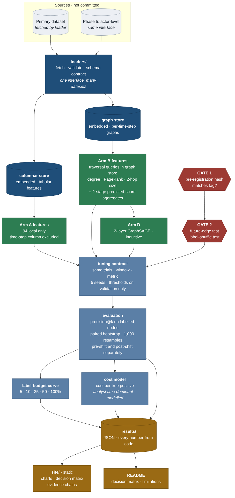
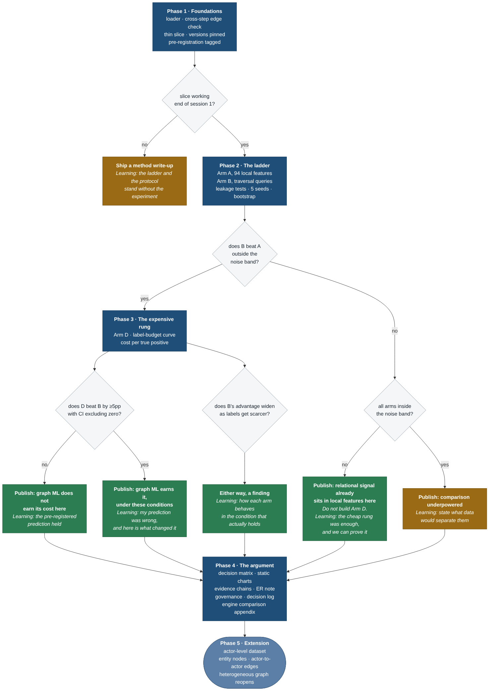

# PRD: graph-risk-evals

**Document name:** When does a graph earn its cost in fraud and AML detection?
**Purpose:** Specify a public, reproducible lab that measures where graph methods start and stop paying for themselves in a regulated detection problem.
**Author:** Martin Cook
**Version:** Draft v2.5. Supersedes v1, which remains in the repository unchanged.
**Change history:**
2026-11-19, MCook, v1 first draft
2026-11-19, MCook, v2 after cross-model review. See `docs/prd-review.md`
2026-11-19, MCook, v2.1 graph-store work reinstated as a stated learning objective
2026-11-20, MCook, v2.5 write-up standard added; scope and time box stated

**Status:** Draft. The pre-registration in section 4 must be committed, tagged and hashed before any result is written to `results/`. The pipeline enforces this.

---

## What changed in v2, and why

Two independent model reviews, acting as a sceptical CPTO and a staff engineer, found three errors in v1 that would have invalidated the experiment. All three are corrected here.

1. **Arm A was never graph-free.** The dataset's 166 node features comprise 94 local features and 72 aggregated over one-hop neighbours, the latter built by the dataset's authors as a manual proxy for one round of message passing. An Arm A using all 166 features already contained graph information, so the central hypothesis was wrong by construction. Arm A now uses the 94 local features only, with the time-step column excluded.
2. **The headline comparison is already published.** The dataset's own paper reported a random forest beating a two-layer graph convolutional network on illicit F1, and performance collapsing after the regime shift at time step 43. v1 read as a first encounter with the dataset. Section 2 now states prior results and what this adds.
3. **Label-derived graph features leak.** Time steps are disjoint graphs with no edges between them, so a hop-distance-to-a-confirmed-bad-actor feature computed at test time can only draw on labels within that same test step. Those features are removed and replaced with neighbour aggregates of the model's own predicted scores.

Scope changes: language-model explanation summaries are removed; the interactive threshold explorer is demoted to P2; the unsupervised arm is deferred; a label-budget curve is added; the cost model is replaced; a decision matrix becomes the README centrepiece.

**v2.1 adds an explicit learning objective.** Working knowledge of graph databases is a stated goal of this lab, not a by-product. Two consequences. Arm B's structural features are computed in the embedded graph store as traversal queries rather than in a Python graph library, at P0, because that is where the learning sits and the queries themselves become an artefact. The engine comparison returns at P1 as a timeboxed appendix, accepting that it is the most attackable item in the repository, because a documented comparison is worth more to the author than the risk it carries. The appendix states plainly what it does not establish. A one-page note on entity resolution is added, as the layer beneath every fraud graph.

---

## TL;DR

Organised fraud lives in the relationships between accounts, so evidence relevant to one entity may sit with its neighbours. Graph methods exist to exploit that. They are also expensive to operate, hungry for labels that arrive late and rarely, and harder to explain to an investigator or a regulator than the methods they replace.

This lab measures that trade-off on a published, labelled transaction graph. Three arms are built in increasing order of cost, from a clean tabular baseline through graph-derived features to a graph neural network, each on the same time-aware split, at the same pre-committed operating point, with cost expressed per true positive rather than per scored entity. A label-budget curve tests how each arm behaves when labels are scarce.

The hypotheses are numerically defined and committed before any result exists. Whatever the result, it is published.

---

## Context

Detection systems in payments mostly score one transaction at a time. Evidence that an entity is part of an organised group may sit in its neighbours rather than in the entity itself, which is the case graph methods are built for.

**What this does not claim.** Transaction-level monitoring is not incapable of catching organised fraud. A well-engineered tabular model can capture relational signal indirectly through aggregates. That is precisely what Arm A against Arm B is designed to test: whether explicitly representing relationships adds measurable value beyond a properly tuned tabular representation of the same historical information.

The decision facing a product leader is not whether graphs can find rings. It is whether the lift justifies the operating cost, the label requirements and the loss of explainability, measured against a baseline that has been tuned properly rather than left weak for comparison.

**Why this matters commercially.** In cross-border payments the margin kept per transaction is often well under one percent and is being compressed deliberately to win volume. Fraud losses, analyst time spent on false positives, and the compute running detection draw on the same slice. Of those, analyst time dominates. A detection capability has to pay for itself in alerts an investigator can work, not in compute.

---

## Prior results and what this adds

The dataset's own paper established the comparison this lab repeats. A random forest on the full feature set outperformed a two-layer graph convolutional network on illicit F1, and every model degraded sharply after the regime shift at time step 43. Subsequent public work has examined temporal against random splits and leakage-free inductive protocols.

**This lab does not claim novelty in the headline comparison.** What it adds:

1. **A cleanly separated baseline.** Arm A uses local features only, so the lift attributable to graph information is actually isolated. Published comparisons frequently use all 166 features in the baseline, which already contains neighbour aggregates.
2. **A fixed alert budget.** Results are reported at a pre-committed operating point representing a finite review queue, rather than at an unconstrained threshold.
3. **Cost per true positive**, dominated by analyst time, rather than model performance reported alone.
4. **A label-budget curve.** How each arm behaves at 5, 10, 25, 50 and 100 percent of available training labels. This is the condition that actually holds in financial crime, and it is not well covered in the published comparisons.
5. **Equal and documented tuning**, with the protocol specified in advance.

---

## Goals and objectives

**Honesty.** Hypotheses are numerically defined and committed before the first result. The commitment is enforced by a hash check, not by trust. The finding is published whatever it is, including a null result.

**Comparability.** Every arm uses the same data, the same temporal split, the same validation window, the same tuning protocol and the same operating point.

**Economics.** Cost is expressed per true positive, with analyst time as the dominant term and compute shown at its true scale.

**Explainability.** Arm B produces structural evidence chains. Where an arm cannot produce a meaningful one, that is recorded as a finding about the method rather than worked around.

**Reproducibility.** One command on a clean clone, pinned versions, laptop CPU, under 30 minutes. Every figure generated by code.

**Transferability.** The method generalises to other regulated detection problems. The dataset does not, and the limitations section says exactly what is demonstrated, what is suggested, and what cannot be established.

**Legibility.** A reviewer arriving cold can find the answer, the reasoning behind every material decision, and the limits of both, without reading the code. The scope is stated plainly: a learning project, run as a two-day discovery sprint, with what that time box leaves out named beside the claims it qualifies.

**Safety.** Public data only. No employer data. Production experience appears in the decision log at the level of decisions and reasoning, with industries named rather than companies.

---

## Non-goals

**Confirmed exclusions.**

- **Not a fraud detection product.** No deployment, no serving layer, no production-readiness claim.
- **No real-time benchmarking.** The dataset is static and small. Ingest throughput, concurrency and freshness are not testable and no claim is made about them.
- **No production experience claimed.** The framing is: built to test where graph stops paying for itself.
- **No language-model explanation summaries.** They add a model dependency and a second evaluation problem, faithfulness, which is not the question this repo answers. Deterministic evidence chains are sufficient and stronger.
- **No database engine benchmark as a headline result.** See Trade-offs.
- **No GraphRAG, no knowledge graphs, no recommendation engine.** Named in the README as graph use cases deliberately not built.
- **No HIPAA or FedRAMP mapping.** One line in governance on why regime fragmentation constrains cross-border fintech, nothing more.
- **No heterogeneous graph in v1.** The primary dataset has a single node type, so introducing one would mean inventing node types. Closed for this dataset, and conditionally reopened if the actor-level extension is adopted in Phase 5, since that dataset carries two genuine node partitions with different feature sizes.

**Not yet defined.** Second dataset, orchestration, continuous integration, adversarial tests for cold start and camouflage. Deferred, not ruled out.

---

## Hypothesis and pre-registration

**Committed as `01-the-bet/pre-registration.md`, tagged `prereg-v1`, before any result is written. The pipeline hashes this file and refuses to write to `results/` if the hash does not match the tag.**

**Definitions used throughout.**

- **Pre-shift period:** test time steps 35 to 42. **Post-shift period:** 43 to 49. Training 1 to 29, validation 30 to 34.
- **Primary metric:** precision at k on labelled nodes, where **k is the mean number of illicit labels per time step across steps 1 to 34**, computed in code before any test step is read. This mirrors how an operations team sizes a review queue from historical case volume.
- **Evidence unit:** 5 random seeds per arm, paired bootstrap of 1,000 resamples stratified by time step.
- **Noise band:** the 95% bootstrap confidence interval on the difference between two arms includes zero.

**H1.** Graph-derived features capture the majority of available lift, defined as (B − A) / (max(B, D) − A) ≥ 0.5, measured on PR-AUC over the pre-shift period. If Arm A is the best arm, H1 is undefined and that is itself the finding.

**H2.** The graph neural network does not justify its cost. H2 is rejected only if Arm D beats Arm B on precision at k by at least 5 percentage points **and** the 95% bootstrap confidence interval on that difference excludes zero, pooled over the pre-shift period.

**H3.** Simpler arms degrade less after the regime shift, measured as the relative fall in PR-AUC from the mean of the pre-shift period to the mean of the post-shift period.

**H4.** The advantage of graph-derived features over the local-feature baseline widens as labels become scarcer, measured across the label-budget curve at 5, 10, 25, 50 and 100 percent of training labels.

**Kill criteria.**

- If Arm B does not beat Arm A outside the noise band, publish that and do not build Arm D.
- If all arms fall within the noise band of each other, the finding is that the comparison is underpowered on this data. State what would be needed to separate them.
- If the pre-registration is not committed and tagged before the first result, the comparison is abandoned and the repo ships as a method write-up only.

**No threshold, hyperparameter or operating point is chosen on test steps, at any point, for any arm.**

---

## Success metrics

Cost figures are **modelled, not measured**, and are labelled as such wherever they appear.

| Metric | Definition | Reported as |
|---|---|---|
| Precision at k | On labelled nodes, at the pre-committed k | Primary, with 5-seed mean and bootstrap CI |
| Recall at k, PR-AUC | Same population and operating point | Secondary diagnostics |
| Full precision-recall curve | All operating points | Published, so k is not load-bearing |
| Unlabelled share of top-k | When ranking all nodes | Reported, to expose the ambiguity rather than hide it |
| Cost per true positive | (k × analyst cost per alert + compute) / true positives | Modelled. Analyst cost assumed at a stated figure with a ±50% range |
| Build cost | Days spent per arm | Recorded. A real cost, and free to log |
| Relative degradation | Pre-shift to post-shift fall in PR-AUC | Per arm |
| Label-budget curve | Precision at k by training-label fraction | Per arm |

**Red lines.** Numeric and blocking.

- No result is written while the leakage tests fail.
- No result is written if the pre-registration hash does not match its tag.
- No arm is compared on a different split, feature set, validation window or operating point.
- No number appears in the repo that was not produced by code.
- No modelled figure is presented as measured.
- No win is declared on a difference whose confidence interval includes zero.

---

## Solution overview

### The escalation ladder

The organising argument. Each rung is climbed only once the one below has been measured and plateaued.

1. Rules and thresholds.
2. Local features in a tuned tabular model.
3. Graph-derived features added to that model.
4. Graph algorithms proper.
5. Graph neural networks.

### Experiment arms

| Arm | Features | Rung |
|---|---|---|
| A | 94 local features only, time-step column excluded. Tuned gradient-boosted trees | 2 |
| B | Arm A plus the 72 provided neighbour aggregates, plus computed structural features | 3 |
| D | 2-layer GraphSAGE, inductive, architecture family fixed in advance | 5 |

Arm C, unsupervised community detection, is deferred. On small disjoint per-step graphs scored against incomplete labels it produces a noisy result that is hard to interpret, and it does not serve the central question.

**Structural features for Arm B**, chosen because they are computable from this data without label leakage:

- In-degree and out-degree.
- PageRank within the time step.
- Two-hop neighbourhood size.
- Neighbour aggregates of the model's own predicted scores, computed in two stages.

**These features are computed in the embedded graph store, as traversal queries, not in a Python graph library.** The queries are committed to `graph/queries/` and are a deliverable in their own right. This costs marginally more than the library route and is the point: working knowledge of graph query languages and traversal cost is a stated objective of this lab. Where a query proves materially slower or more awkward than the equivalent library call, that is recorded as a finding rather than quietly worked around.

**Removed from v1:** shared-attribute degree, beneficiary fan-in and cluster formation speed. The dataset has no accounts, devices, addresses or opening dates, so these cannot be computed. They are retained in the README only as *what this would be on payments data*.

### Architecture

Six layers, each with one job, and two gates that can stop the pipeline.

| Layer | What it does | Why it is separate | Requirement |
|---|---|---|---|
| **Sources** | Datasets fetched by script, never committed | Licensing, repository size, and reproducibility from a clean clone | Data requirements |
| **`loaders/`** | Fetch, validate, enforce a schema contract | One interface, many datasets. The Phase 5 extension plugs in here rather than forcing a rebuild | 1, and the Phase 5 note |
| **Stores** | Embedded graph store for per-time-step graphs; embedded columnar store for tabular features | Each engine does the query shape it is suited to. Both are file-based, so the repository stays static | 11, 17 |
| **Features** | Arm A from the columnar store, Arm B from traversal queries in the graph store, Arm D consuming the graph directly | Arm A's isolation is enforced by where its features come from, not by a comment | 4, 11 |
| **Protocol** | Tuning contract, then evaluation, then the cost model and label-budget curve | One protocol applied identically to every arm. Deviation is a reportable failure, not a footnote | 5, 6, 7, 8, 9 |
| **Outputs** | `results/` as JSON, consumed by the site and the README | Every figure is generated by code and read from one place | 10, 12, 16 |
| **Gate 1** | Hashes the pre-registration and compares it to the tagged commit. Mismatch halts the run | Converts the commitment from a promise into a mechanism | 2 |
| **Gate 2** | Inserts a future edge and asserts no earlier feature value changes; shuffles test labels and asserts no feature value changes | The first catches temporal leakage, the second catches label-derived leakage. Either failing fails the build | 3 |

Requirement numbers are maintained here rather than on the diagram, because the image would need re-rendering every time the specification is renumbered.

**Design decisions worth stating.**

- **Arm A never touches the graph store.** Its isolation is structural. A reviewer can verify it by reading the data flow rather than trusting a feature list.
- **Arm B's features are traversal queries**, committed under `graph/queries/`. They are a deliverable, not an implementation detail.
- **Nothing is served.** The site reads static JSON. No API, no keys, no network at view time.
- **The loader interface exists from the first commit**, because the second dataset is a planned phase rather than a hypothetical.

### Experiment junctions

Every path terminates in a publishable finding. That is the point of pre-registering: there is no branch where the honest outcome is to abandon the work quietly.

Two branches end the experiment early, by design. If the thin slice is not working at the end of session one, the repository ships as a method write-up. If Arm B does not beat Arm A outside the noise band, Arm D is never built and the finding is that relational signal already sits in the local features for this data.

Every junction on the diagram is a kill criterion or a hypothesis test from `01-the-bet/pre-registration.md`. The diagram carries no thresholds, deliberately: the numbers live in the pre-registration, which is hashed and tagged, so a reader checks them there rather than trusting an image.

### Tuning contract

Identical across arms, specified before implementation.

- Same search method and the same number of trials per arm.
- Same training window, same temporal validation window.
- Same primary optimisation metric.
- Same early-stopping rule, class weighting and threshold selection rule, with thresholds chosen on validation steps only.
- Fixed seeds, 5 per arm.
- GNN architecture family fixed in advance. Any architecture search counts against its trial budget.
- **Equal trials is not equal compute.** Both trial count and training compute are recorded and reported.

### Feature availability contract

For each evaluation time step: build the graph from edges available at that time, compute features from that graph only, use only labels available by that time. No future edge, degree, community membership or confirmation may influence a historical feature value.

Two automated tests enforce this:

- Insert a future edge, assert earlier feature values do not change.
- Shuffle test labels, assert every feature value is unchanged.

### Evaluation population

Metrics are computed on labelled nodes only, stated explicitly. Unlabelled does not mean legitimate, and unlabelled entities are never treated as negatives. The unlabelled share of the top-k queue is reported separately when ranking across all nodes.

---

## Requirements

| # | Requirement | Priority | Acceptance criteria |
|---|---|---|---|
| 1 | Reproducible pipeline | P0 | One command on a clean clone runs load, build, all arms, evaluation and export. Pinned versions. Under 30 minutes on a laptop CPU |
| 2 | Pre-registration enforcement | P0 | Pipeline hashes the pre-registration and refuses to write `results/` on mismatch with the tagged commit |
| 3 | Feature availability tests | P0 | Both tests above pass. Build fails if either does not |
| 4 | Clean Arm A | P0 | Arm A uses 94 local features, time-step column excluded. Asserted in code, not in prose |
| 5 | Tuning contract | P0 | Executed as specified. Trial count and training compute recorded per arm in `results/` |
| 6 | Statistical evidence | P0 | 5 seeds per arm, paired bootstrap, confidence intervals on every reported difference |
| 7 | Operating point | P0 | k computed from training steps before any test step is read. Full PR curve also published |
| 8 | Cost per true positive | P0 | Modelled, with analyst cost assumption, sensitivity range, and compute shown at true scale. Build days logged per arm |
| 9 | Label-budget curve | P0 | Each arm trained at 5, 10, 25, 50 and 100 percent of training labels, same protocol throughout |
| 10 | Counts from code | P0 | Every figure in README and site read from `results/` |
| 11 | Arm B features in the graph store | P0 | All structural features computed as traversal queries in the embedded graph store. Queries committed to `graph/queries/`. Any query materially slower or more awkward than the library equivalent is recorded as a finding |
| 11b | Evidence chains, Arm B | P1 | Structural evidence chain per flagged entity, generated from the same traversal queries. Coverage reported. Arm D's inability to produce a meaningful one recorded as a finding |
| 12 | Decision matrix | P1 | Finding, product decision, supporting evidence. The README centrepiece |
| 13 | Limitations | P1 | Separates what is demonstrated, what is suggested, and what cannot be established |
| 14 | Governance note | P1 | One page: data handling, limitations, sovereignty and residency. Nothing further |
| 15 | Decision log | P1 | Anonymised production decisions mapped to ladder rungs, industry named rather than employer |
| 16 | Static charts | P1 | Precision, recall and queue volume across operating points, as static charts in README and site |
| 17 | Engine comparison appendix | P1 | Timed traversal and aggregation workloads on the embedded graph store and a columnar store. Half a day maximum. Configuration, hardware and confounds listed. States plainly what it does not establish |
| 18 | Entity resolution note | P1 | One page: entity resolution as the layer beneath the graph, the over-merge against under-merge trade-off, and why it is not demonstrated on this dataset |
| 19 | Threshold explorer | P2 | Interactive, from precomputed values. Built only after P0 and P1 complete |
| 20 | Unsupervised arm, second dataset, orchestration, CI | P2 | Deferred |
| 21 | Write-up | P1 | The README reads cold. It leads with the answer, then gives the reasoning behind each material decision: why it was made, what it costs and what else was considered, linked to where it is recorded. It states that this is a learning project run as a two-day discovery sprint, and what that scope leaves out, beside the claims it qualifies. Written in the author's voice: plain, polite British English, no em dashes. Drafts are marked until the author has edited them |

---

## Data requirements

**Primary dataset.** A published, labelled transaction graph: approximately 203,000 nodes, 234,000 directed edges, 49 time steps, 166 node features comprising 94 local and 72 one-hop aggregates, labels approximately 2 percent illicit, 21 percent licit, 77 percent unlabelled. Time steps are disjoint; confirm in the loader.

**Licensing.** Datasets are not committed to the repository. A loader fetches them. The README records source, licence and any restriction on redistribution or commercial use.

**Removed from v1.** The golden set and the labelling protocol. The dataset is static, no human confirms anything, and documenting a confirmation workflow that nobody runs is theatre. The label-budget curve answers the real question about label scarcity instead.

**Loader interface.** Datasets sit behind a loader interface from the first commit, so that a second dataset is additive rather than a rebuild.

**The planned second dataset, Phase 5.** An actor-level extension of the primary dataset, verified as containing roughly 822,000 wallet-address nodes with 56 features each, 1.27 million temporal interactions, and three real edge sets: address to address, address to transaction, and transaction to address. Transactions in it carry 182 features: the original 93 local and 72 one-hop aggregates, plus 17 structural.

Why it is the right next step rather than a different dataset:

- **Wallet addresses are entities.** That is as close to accounts as this data family reaches, and it moves the work off the "nodes are transactions" limitation that constrains every payments claim here.
- **Address-to-address edges are the mule-network shape.** Actor connected to actor, rather than payment flowing to payment.
- **Same lineage**, so loader work is small and the pipeline carries over.

Three things to settle before adopting it, none of which are v1 work:

1. **Scale.** Roughly 5 million edges across the three sets against 234,000 here. The 30-minute compute budget must be rechecked.
2. **Feature overlap and leakage.** The 17 added structural transaction features may duplicate the structural features computed for Arm B and carry their own availability questions.
3. **Prior art.** Published work already compares transaction-level and actor-level detection queues on this dataset. Read it first and position as a stricter replication, exactly as section 2 does here.

**Alternative, if payments semantics matter more than entity structure.** A synthetic mobile-money transaction set with sender and receiver fields, from which a transfer graph can be built: accounts, transfers and cash-outs. The caveat is that it is rule-generated, so a model may learn the generator rather than the fraud. Lower priority than the actor-level extension.

Neither is in v1. The limitation is stated as a sequenced plan rather than left as an unexplained boundary.

---

## Evals and guardrails

**Eval stack**, layered, following the pattern in `ai-evals`:

- Split integrity, feature provenance and metric computation, each checked in code.
- Pre-shift and post-shift periods reported separately, never pooled into one headline.
- A human rubric for evidence chains: is the reason true, sufficient, and actionable by an investigator.

**Bounds in code**, following the pattern in `pm-os-agent`: caps on runtime, enforced in code rather than described in prose.

**Removed from v1.** The autonomy split. Nothing here is deployed, and specifying an approval architecture for a static experiment is production theatre.

---

## Critical user journeys

Scored with RICE. Effort in days. Moved to an appendix in the README so that the method leads.

| ID | Theme | User story | Priority | R | I | C | E | RICE |
|---|---|---|---|---|---|---|---|---|
| 1 | Honesty | As a reviewer, I want the hypothesis tagged and hash-enforced before results, so that I can trust it was not written backwards | M | 5 | 3 | 1.0 | 0.25 | 60 |
| 2 | Comparability | As an engineer, I want a baseline that excludes neighbour aggregates, so that graph lift is actually isolated | M | 5 | 3 | 0.9 | 0.5 | 27 |
| 3 | Evidence | As an engineer, I want confidence intervals on every difference, so that small gaps are not reported as wins | M | 5 | 3 | 0.9 | 0.5 | 27 |
| 4 | Economics | As a product leader, I want cost per true positive, so that performance is never reported alone | M | 4 | 3 | 0.8 | 0.5 | 19.2 |
| 5 | Labels | As a fraud lead, I want to see how each arm behaves as labels get scarcer, because that is my actual condition | M | 4 | 3 | 0.8 | 0.5 | 19.2 |
| 6 | Method | As a practitioner, I want the ladder stated and each rung measured, so that I can reuse the decision rule | M | 4 | 3 | 0.9 | 0.5 | 21.6 |
| 7 | Decision | As a product leader, I want a matrix mapping finding to decision, so that the result tells me what to do | M | 4 | 3 | 1.0 | 0.25 | 48 |
| 8 | Explainability | As an investigator, I want a structural reason per flag, so that I can act on it or dismiss it | S | 3 | 2 | 0.8 | 0.75 | 6.4 |
| 9 | Durability | As a reviewer, I want to clone and run it in one command, so that I can verify rather than trust | S | 3 | 3 | 0.8 | 0.75 | 9.6 |
| 10 | Honesty | As a reader, I want demonstrated, suggested and unestablished separated, so that I know what the result supports | M | 4 | 3 | 1.0 | 0.1 | 120 |
| 11 | Governance | As a compliance lead, I want data handling and sovereignty addressed, so that I can see the design anticipated them | S | 3 | 2 | 0.9 | 0.25 | 21.6 |

**Removed from v1:** the hiring-manager story. Naming the audience as recruiters inside a document whose value rests on genuine inquiry reframes every honesty commitment as positioning. The decision log serves the same purpose by not announcing itself.

**Open:** RICE inputs are my own estimates with no second scorer. In a team these would be scored with engineering and analytics present.

---

## Risks

### Problem space

1. **The dataset is not payments data** (9/10 that this limits transferability). Bitcoin transactions with anonymised features, no accounts, devices or addresses. *What would move this:* a payments-semantic second dataset behind the same loader. Not in v1.
2. **Anonymised features limit interpretability** (8/10). Explanations over feature 37 explain nothing. *Mitigation:* evidence chains drawn from graph structure, which is interpretable, not from node features.
3. **Label bias toward previously caught fraud** (8/10 present). Any supervised arm partly learns the previous detection regime. *What would move this:* the deferred unsupervised arm, and the label-budget curve, which at least shows sensitivity to label volume.
4. **The result may be uninteresting** (7/10 likely). A clean tabular baseline may win outright. *Position:* that is a publishable finding, and the label-budget curve, cost per true positive and clean Arm A are what make it worth reading.

### Solution space

1. **Weak or unclean baseline invalidates everything** (8/10 if uncontrolled). Addressed by Requirements 4 and 5.
2. **Temporal and label leakage** (8/10 if uncontrolled). Addressed by Requirement 3 and the feature availability contract.
3. **Underpowered statistics** (7/10). Few illicit labels per step, especially post-shift. Addressed by Requirement 6.
4. **Cost model challenged** (7/10 certain). *Mitigation:* analyst time as the dominant term, assumptions stated, sensitivity published, compute shown at true scale, everything labelled modelled.
5. **Scope creep past the deadline** (6/10). *Mitigation:* v1 ships after Phase 3 with static charts in the README if nothing else is ready.
6. **Library and API drift** (5/10). *Mitigation:* versions pinned on day one, thin end-to-end slice first.

---

## Trade-offs, assumptions and open questions

**Build or buy.** An embedded graph store, to keep the repository static and runnable from a clean clone. This trades the features of a managed graph platform for reproducibility, which is right for a lab and wrong for production.

**Engine comparison.** The production decision, where a real-time workload turned out to be aggregation rather than traversal and moved to a columnar store, is recorded in the decision log as lived experience.

Both reviews recommended cutting the benchmark, correctly identifying it as the most attackable claim in v1: at 234,000 edges it largely times start-up, caching and query planning rather than anything architectural. **It is reinstated at P1 anyway, deliberately, and the reasoning is recorded here rather than hidden.** Working knowledge of how traversal and aggregation workloads behave on different engines is a stated objective of this lab, and the author judged that learning to be worth more than the risk the claim carries. The appendix is timeboxed to half a day, lists configuration, hardware and confounds, and states plainly that it establishes query-shape behaviour on one small static dataset and nothing about production economics at scale.

**Real-time.** Not testable here. No claim made.

**Data governance and cataloguing.** Lineage is emitted as a structured artefact rather than managed in a catalogue tool. In an enterprise this is where a catalogue with lineage support belongs, and the design names that boundary.

**Data sovereignty.** Cross-border payment graphs and data residency pull against each other: the edges carrying most signal are often those crossing jurisdictions, and residency rules constrain where they may be joined. One page, including the role of access logging in proving who could see what. This comes from production experience rather than from the dataset, and it is the most original element of the governance set.

**Compute.** Everything runs on a laptop CPU at this size. No claim is made about behaviour at a scale where it would not.

**Open questions.**

| Question | Why it matters | Status |
|---|---|---|
| What analyst cost per alert should the model assume? | It is the dominant cost term, so the assumption drives the conclusion | Open. Must be fixed and justified before results |
| Do time steps contain cross-step edges? | If they do, the leakage analysis changes | Open. Confirm in the loader on day one |
| Does the two-stage predicted-score aggregation itself leak? | It is the replacement for the removed label-distance features | Open. Design and test before Arm B runs |

**Closed in v2.** Whether the GNN needs a heterogeneous graph: no for the primary dataset, which has one node type. This reopens if the actor-level extension is adopted in Phase 5, where two genuine node types exist and a heterogeneous model becomes the honest choice rather than an invention. Whether k stays undecided: no, it is defined above and computed before test data is read. Whether the cost model uses list prices: no, a transparent unit model dominated by analyst time.

---

## Roadmap

**Phase 1, Foundations.** Thin end-to-end slice: data loaded, cross-step edges confirmed, one metric produced, one chart rendered, versions pinned. Pre-registration committed, tagged and hash-enforced. *Kill criterion: if the slice is not working by the end of the first session, drop Arm D and ship a method write-up.*

**Phase 2, The ladder.** Arms A and B under the tuning contract, with the feature availability tests passing and bootstrap confidence intervals. *Kill criterion: if Arm B does not beat Arm A outside the noise band, publish that and do not build Arm D.*

**Phase 3, The expensive rung and the economics.** Arm D. Label-budget curve. Cost per true positive. Decision matrix. Limitations.

**Phase 4, The argument.** Static charts, structural evidence chains, governance note, entity resolution note, decision log, engine comparison appendix, and the write-up to requirement 21.

**Phase 5, Extension.** The actor-level dataset behind the existing loader interface, which brings entity nodes, actor-to-actor edges and a genuine heterogeneous graph. Then: threshold explorer, unsupervised arm, entity resolution as a working module, orchestration with lineage, CI, adversarial tests for cold start and camouflage.

---

## Appendix

**Cross-model review.** Two independent reviews, each asked to act as a sceptical CPTO and as a staff engineer in graph and ML systems. Prompt and both replies verbatim in `PROMPTS.md`. Issue-by-issue disposition in `docs/prd-review.md`, including where reviewers disagreed and which side was taken.

**Related repositories.** Conventions, eval structure, strategy framing and roadmap format carried across from the existing portfolio rather than reinvented. Named in the README.

**Changelog.**

| Date | Version | Changes | Author |
|---|---|---|---|
| 2026-11-19 | Draft v1 | Initial draft for review | MCook |
| 2026-11-19 | Draft v2 | Three invalidating errors corrected. Scope rebalanced after cross-model review | MCook |
| 2026-11-19 | Draft v2.1 | Graph-store learning made an explicit objective. Arm B features computed as traversal queries at P0. Engine comparison reinstated at P1 against review advice, with the reasoning recorded. Entity resolution note added. Loader interface and second-dataset candidates stated | MCook |
| 2026-11-19 | Draft v2.2 | Second dataset verified and named as the Phase 5 extension: actor-level dataset with wallet nodes and real actor-to-actor edges. Heterogeneous-graph closure made conditional on it | MCook |
| 2026-11-19 | Draft v2.3 | Architecture section, data-flow diagram and experiment-junctions diagram added | MCook |
| 2026-11-19 | Draft v2.4 | Requirement traceability added to the architecture table. Junction thresholds pointed at the pre-registration rather than the diagram | MCook |
| 2026-11-20 | Draft v2.5 | Write-up standard added as a goal and as requirement 21: answer first, reasoning for each material decision, and the scope and two-day time box stated beside the claims. No hypothesis, definition, metric or protocol changed | MCook |
